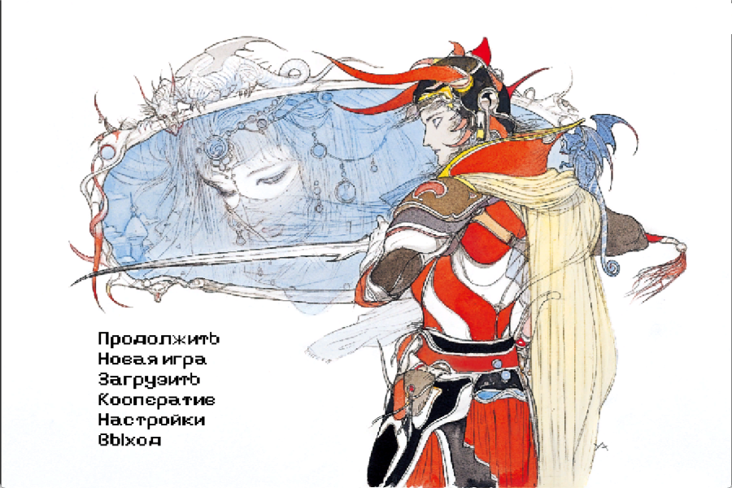
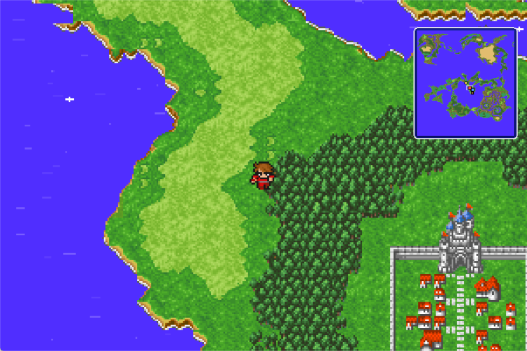
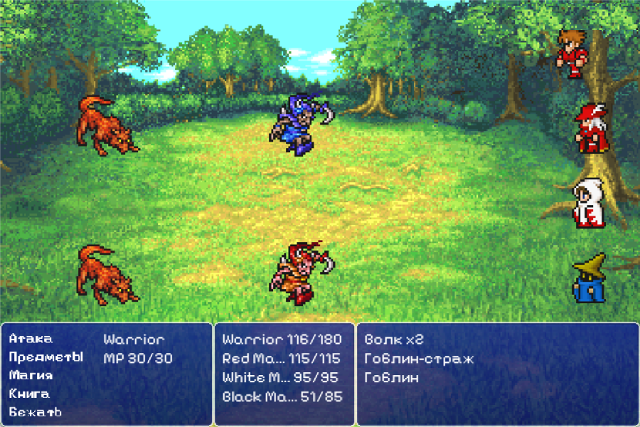
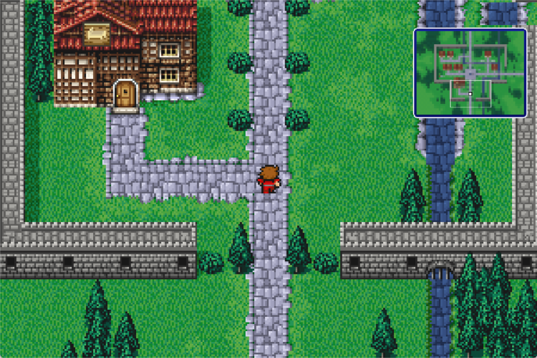
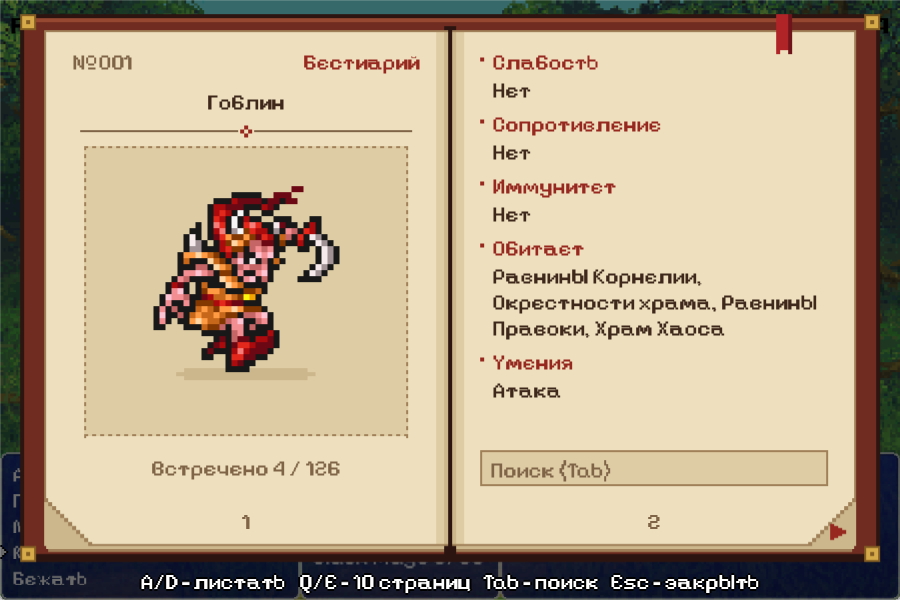
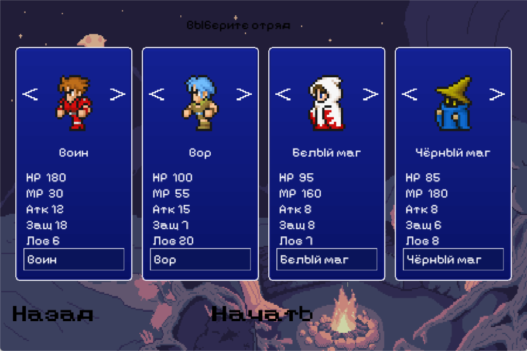
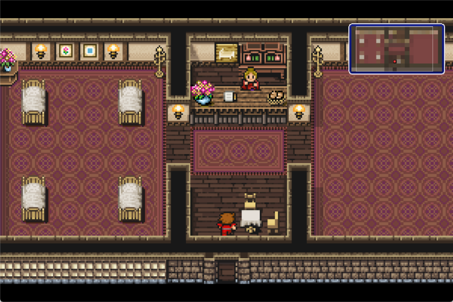

<div align="center">

# ⚔️ RPG

**Пошаговая ретро-RPG на C++20 и SDL2 по мотивам Final Fantasy I**

[](https://github.com/Negtab/RPG/actions/workflows/ci.yml)




</div>

---

## 🖼️ Скриншоты

<table>
  <tr>
    <td></td>
    <td></td>
  </tr>
  <tr>
    <td align="center"><sub>Карта мира</sub></td>
    <td align="center"><sub>Пошаговый бой</sub></td>
  </tr>
  <tr>
    <td></td>
    <td></td>
  </tr>
  <tr>
    <td align="center"><sub>Корнелия</sub></td>
    <td align="center"><sub>Бестиарий</sub></td>
  </tr>
  <tr>
    <td></td>
    <td></td>
  </tr>
  <tr>
    <td align="center"><sub>Меню отряда</sub></td>
    <td align="center"><sub>Гостиница</sub></td>
  </tr>
</table>

## ✨ Возможности

| | |
|---|---|
| 🗺️ **Открытый мир** | Карта мира из [Tiled](https://www.mapeditor.org/) (`.tmj`), тайловые коллизии, реки, блики на воде, переходы между картами |
| 🏰 **8 городов и подземелья** | Корнелия, Правока, Эльфхейм, Мелмонд, Кресент-Лейк, Онрак, Гайа, Луфения и Храм Хаоса |
| 🛒 **Магазины** | Оружие, броня, предметы, белая и чёрная магия, гостиница и церковь, снаряжение из FF1 |
| 📜 **Сюжет на Lua** | Диалоги, выборы, флаги, квесты и сцены в скриптах `resources/Story/*.lua`; цепочка Корнелии уже готова |
| 🧙 **6 классов FF1** | Воин, Вор, Монах, Красный, Белый и Чёрный маг: свои навыки, рост характеристик и стартовое снаряжение |
| ⚔️ **Пошаговые бои** | До 9 врагов, навыки, магия, предметы, эффекты атак, стихийные сопротивления и уязвимости, задние фоны по местности |
| 🔁 **Автобой** | Кнопка **Auto** повторяет последнюю команду каждого героя |
| 👾 **126 врагов** | Встречи зависят от ближайшего ориентира, местности и уровня отряда; таблицы добычи |
| 📖 **Бестиарий** | Книга врагов с поиском, доступна из меню и прямо в бою |
| ⛵ **Транспорт** | Корабль с портами, речное каноэ и дирижабль |
| 🧭 **Мини-карта** | Три уровня масштаба |
| 💾 **Сохранения** | Несколько слотов с удалением, автосохранение при смене карты, экран Game Over |
| 🌐 **Онлайн** | Совместное путешествие и бои по сети (TCP, порт `54000`) |
| 🌍 **Языки** | Русский и английский интерфейс и диалоги |
| 🖥️ **Полный экран** | С сохранением пропорций 900×600 |
| 🎵 **Звук** | Свои темы для меню, карты, боя и магазина; отдельная громкость музыки и звуков |

## 🎮 Управление

| Клавиша | Действие |
|---|---|
| `W A S D` / `← ↑ → ↓` | Движение, навигация по меню |
| `Enter` / `Space` | Подтвердить, заговорить с персонажем |
| `Esc` / ПКМ | Назад / игровое меню |
| `E` | Сесть в транспорт / выйти из него |
| `V` | Сменить героя, который идёт по карте |
| `M` | Мини-карта: выкл → ×1 → ×2 → ×3 |
| `H` | Включить / выключить случайные бои |
| `B` (в бою) | Открыть бестиарий |
| `Q` / `E` (в меню) | Переключить героя; в бестиарии — листать страницы |
| `Tab` (в бестиарии) | Поиск врага |
| `Y` / `N` | Ответ в диалоге «да / нет» |
| `F11` / `Alt+Enter` | Полный экран |
| `Ctrl+V` | Вставить текст в поле ввода (например, IP-адрес) |

## 📦 Установка

Готовый установщик `RPG-Setup-<версия>.exe` ставит игру без прав администратора в `%LOCALAPPDATA%\Programs\RPG`. Сохранения и `settings.ini` лежат там же и при удалении игры не стираются.

Если Windows предупредит о неизвестном издателе: **Подробнее** → **Выполнить в любом случае**.

## 🔧 Сборка

### Требования

- **Windows** + **MinGW-w64** (x86_64)
- **CMake** 3.22+
- SDL2, SDL2_image, SDL2_mixer, SDL2_ttf, Lua 5.4 и nlohmann/json уже лежат в репозитории
- GoogleTest скачивается автоматически при первой сборке

### Через CLion

Откройте папку проекта, выберите тулчейн MinGW и нажмите **Run**.

### Из терминала

```bash
cmake -S . -B cmake-build-debug -G Ninja
```

```bash
cmake --build cmake-build-debug
```

Исполняемый файл собирается статически; рядом с ним должны лежать `SDL2*.dll` и папка `resources/`.

### Установщик

Нужен [Inno Setup 6](https://jrsoftware.org/isinfo.php) (`winget install JRSoftware.InnoSetup`). Скрипт соберёт Release и упакует его в `installer/Output/RPG-Setup-<версия>.exe`:

```bash
powershell -ExecutionPolicy Bypass -File installer/build_installer.ps1 -Version 1.2.0
```

Если CLion стоит не в `D:\CLion 2025.3.2`, передайте путь параметром `-CLionDir`.

## 🧪 Тесты

Юнит-тесты на [GoogleTest](https://github.com/google/googletest) лежат в `tests/` и проверяют логику персонажей на настоящих данных игры.

```bash
ctest --test-dir cmake-build-debug --output-on-failure
```

Отключить сборку тестов можно флагом `-DRPG_BUILD_TESTS=OFF`. Новый файл с тестами нужно добавить в [tests/CMakeLists.txt](tests/CMakeLists.txt).

**CI:** [GitHub Actions](.github/workflows/ci.yml) собирает игру в MSYS2/MinGW и прогоняет тесты на каждый push в `main` и `Dev` и на каждый pull request.

## 📜 Сюжетные скрипты

Сцены пишутся на Lua. Житель получает сцену через свойство `script` в Tiled (`npc.<имя>`), триггер на карте — через слой `events` (`event.<имя>`). Реплики берутся по id из `text_ru.json` / `text_en.json`.

```lua
function npc.king()
    if flag("princess_saved") and not flag("bridge_built") then
        say("king", "king.thanks.1", "king.thanks.2")
        setFlag("bridge_built")
        quest("save_princess", "done")
        quest("to_pravoka", "active")
    else
        say("king", "king.intro.1")
        quest("save_princess", "active")
    end
end
```

Доступные функции: `say`, `ask`, `flag`, `setFlag`, `hasItem`, `giveItem`, `takeItem`, `giveGold`, `quest`, `battle`, `teleport`, `healParty`, `partyName`.

## 📝 Данные игры

Весь баланс вынесен в `resources/Data/*.json`: героев, врагов, предметы, навыки, добычу и встречи можно менять без пересборки. Например, класс героя:

```json
{ "class": "Warrior",
  "base":     { "hp": 180, "mp": 30, "attack": 12, "defence": 18, "agility": 6 },
  "perLevel": { "hp": 45,  "mp": 2,  "attack": 10, "defence": 9,  "agility": 1 },
  "resists": ["Physical"], "skills": [1, 5],
  "startEquipment": [103, 124, 142] }
```

## 📁 Структура проекта

```
RPG/
├── scripts/
│   ├── main/           # точка входа, игровой цикл, игрок, карты, движение, языки
│   ├── gameLogic/      # бой, герои, враги, NPC, магазины, квесты, игровые данные
│   ├── controllers/    # ресурсы, ввод, аудио, отрисовка
│   ├── story/          # движок Lua-сценариев
│   ├── ui/             # UIManager, сцены, виджеты, магазин, бестиарий, скины окон
│   └── online/         # сервер, клиент и сетевые пакеты
├── resources/
│   ├── Data/           # heroes / enemies / items / skills / drops / encounters (JSON)
│   ├── Maps/           # карта мира, города (Towns/) и подземелья (Dungeons/) в Tiled
│   ├── Story/          # Lua-сценарии и тексты диалогов (ru / en)
│   ├── Lang/           # перевод интерфейса
│   ├── Images/         # фоны, персонажи, враги, города, транспорт, пропсы
│   ├── Animations/     # покадровые анимации
│   ├── Music/  Sounds/ Fonts/
├── tests/              # юнит-тесты GoogleTest
├── tools/              # Python-утилиты для подготовки контента
├── installer/          # скрипт Inno Setup и сборка установщика
├── website/            # сайт игры с формой баг-репорта
├── third_party/        # nlohmann/json, Lua 5.4
└── SDL2*/              # библиотеки SDL2 для MinGW
```

### Архитектура

```
Game
├── UIManager ── Visualizer, Scene → Panel → Button / Image / Window
├── InputManager ── InputController
├── ResourceManager ── JSON-данные, текстуры, карты
├── AudioManager
├── Story ── Lua-сценарии, флаги, квесты
├── Battle ── Hero / Enemy ← GamePerson
└── Server / Client
```

## 🛠️ Инструменты (`tools/`)

| Скрипт | Назначение |
|---|---|
| `make_collision.py` | Анализирует картинку карты и строит слой коллизий для Tiled |
| `make_encounters.py` | Собирает `encounters.json` из списка «область → враги» (`areas.json`) |
| `preview_encounters.py` | Рисует карту областей встреч для проверки |
| `enemies_csv_to_json.py` | Конвертирует таблицу врагов `enemies.csv` → `enemies.json` |
| `slice_enemy_sheet.py` | Нарезает спрайт-лист врагов на отдельные PNG с прозрачным фоном |
| `slice_pr_*.py` | Нарезают спрайты, врагов, фоны, эффекты и города Pixel Remaster |
| `slice_npcs.py` | Нарезает спрайты жителей из Pixel Remaster |
| `name_picker.py` | HTML-страница для сопоставления спрайтов с именами врагов |
| `patch_font.py` | Чинит кириллицу в пиксельном шрифте (недостающие и похожие символы) |
| `make_vehicle_sprites.py` | Генерирует временные спрайты транспорта |

Пример:

```bash
python tools/make_encounters.py --enemies resources/Data/enemies.json --areas tools/areas.json --out resources/Data/encounters.json
```

## 🌐 Сайт

В `website/` лежит лендинг игры со скриншотами, кнопкой скачивания установщика и формой баг-репорта, которая отправляет сообщения в Telegram через `bugreport.php`. Перед деплоем скопируйте `bugreport.config.example.php` в `bugreport.config.php` и впишите свои данные бота: этот файл в git не попадает.

Локальный просмотр:

```bash
python -m http.server 8123 --directory website
```

---

<div align="center">

Сделано с ❤️ на C++ и SDL2

</div>
